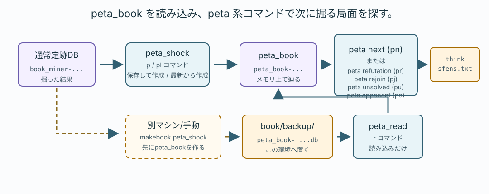
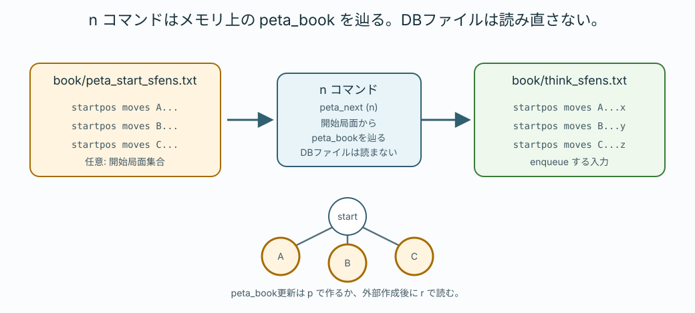

# 11. peta book を使って次に掘る局面を作る

この章では、peta shock 化済みの peta book を使って、次に掘る局面を `book/think_sfens.txt` に書き出す操作を説明します。

peta shock 化そのものは前章で説明しています。

- [10. peta shock 化](10-peta-shock.md)

## 共通の流れ

peta 系コマンドは、読み込み済みの peta book を辿って `book/think_sfens.txt` を作ります。`peta next` では、設定により現在の通常 DB も参照できます。そのあと `enqueue` すると、BookMiner は `book/think_sfens.txt` を通常book上で再生し、まだ掘っていない局面を探索 queue に積みます。

```text
peta_book を読む
  ↓
peta next / peta refutation / peta rejoin / peta unsolved / peta opponent
  ↓
book/think_sfens.txt を作る
  ↓
enqueue
  ↓
通常book上で局面を辿り、必要な局面を探索する
```

ここで重要なのは、peta 系コマンドが辿る DB と、enqueue 後に探索 worker が辿る DB は別だという点です。

- peta 系コマンドは、メモリ上に読み込まれている peta book を辿ります。`peta next` の `通常DBも` がオンのときは、peta book に指し手がない局面で通常 DB も調べます。
- enqueue は、`book/think_sfens.txt` を通常book上で辿ります。
- `book_extend_ply` は enqueue 後の通常book側で使われます。peta book をさらに何手辿るかではありません。



## コマンド一覧

| GUI | CLI | 内容 |
|---|---|---|
| `peta_shock` | `p` | 通常bookを peta shock 化して、その peta book を読み込みます。詳細は [10. peta shock 化](10-peta-shock.md) を参照してください。 |
| `peta_shock_latest` | `pl` | 現在DBを保存せず、`book/backup/` の最新通常bookを peta shock 化して読み込みます。 |
| `peta_read` | `r` | すでに存在する `peta_book-....db` または `peta_book-....ybb` を読み込みます。 |
| `デフォルト値` | `sd eval_diff max_step game_ply_limit book_extend_ply eval_limit` | peta 系コマンドと `enqueue` が `None` や行メタ情報なしで使う共通デフォルト値を設定します。 |
| `peta next` | `pn eval_diff [max_step] [game_ply_limit] [book_extend_ply] [eval_limit] [normal_fallback]` | peta book を root から辿り、leaf の先へ伸ばす候補を `book/think_sfens.txt` に書き出します。`normal_fallback` に `1` を指定すると通常 DB も参照します。 |
| `peta refutation` | `pr eval_refutation_margin [eval_diff] [max_step] [game_ply_limit] [book_extend_ply] [eval_limit]` | `peta next` の leaf のうち、反駁された leaf だけを書き出します。 |
| `peta rejoin` | `pj [eval_drop] [eval_diff] [max_step] [game_ply_limit] [book_extend_ply] [eval_limit]` | peta book から抜けた leaf のうち、合法手1手で peta book に再合流するものだけを書き出します。`eval_drop` で再合流時の評価値低下量を絞れます。 |
| `peta unsolved` | `pu [min_depths] [max_step] [game_ply_limit] [book_extend_ply] [eval_limit]` | 棋譜の各局面で最低depthに満たない指し手のPV leafを書き出します。 |
| `peta opponent` | `po [eval_diff] [max_step] [game_ply_limit] [book_extend_ply] [eval_limit]` | `book/book_opponent/` に置いた相手定跡と現行 peta book を辿り、対策候補 leaf を書き出します。 |
| `enqueue` | `e` / `eb branch_width branch_depth` | `book/think_sfens.txt` を探索 queue に積みます。branch指定を使うと、掘った局面からMultiPV上位手を指定手数先まで展開します。 |

通常は `peta_shock`、`peta_shock_latest`、または `peta_read` で peta book を読み込み、手順2のいずれかで `book/think_sfens.txt` を作り、`enqueue` します。

## まず覚える用語

| 用語 | 意味 |
|---|---|
| root | peta book を辿り始める局面です。通常は平手初期局面です。`peta unsolved` では、負け棋譜の途中局面も入口として使います。 |
| leaf | 定跡 DB の中で、その先の局面がまだ登録されていない末端です。BookMiner はこの先を掘って定跡木を伸ばします。 |
| PV | principal variation の略です。その局面から best move を選び続けた一本道です。 |
| PV leaf | best move を選び続けて到達した leaf です。`book/think_sfens.txt` に書かれることが多いのはこの局面です。 |
| 途中局面 | `startpos moves ...` の棋譜を途中で区切った局面です。例えば `startpos moves 7g7f 3c3d 2g2f` なら、初期局面、`7g7f` 後、`7g7f 3c3d` 後、`7g7f 3c3d 2g2f` 後が途中局面です。 |

## peta next

`peta next` は、peta book から leaf の先へ伸ばす局面を作る基本操作です。

GUIでは `peta next`、CLIでは `pn` コマンドです。

実行中は `peta next` ボタンが `cancel` に変わります。候補の列挙を途中で止めたい場合はこのボタンを押します。キャンセルすると途中結果は `book/think_sfens.txt` に反映されず、実行前のファイルが残ります。自動 enqueue 中の peta next をキャンセルした場合は、その自動 enqueue も停止します。採掘中のエンジンは停止しません。CLI では実行中に `cancel-peta-next` を送ります。

GUI の `通常DBも` をオンにすると、peta book にない局面を現在の通常 DB にも問い合わせ、探索済みならその先まで辿ります。どちらにも指し手がない局面を次の掘削候補にします。オフ（初期値）では従来どおり peta book のみを使います。この設定は手動と自動の peta next に適用され、次回起動時にも保存されます。

例えば、前回の peta shock 化後に `A → B → C` まで新たに掘ったとします。A が peta book の末端で、通常 DB には A と B の指し手が記録されている場合、`通常DBも` がオフなら A を候補にします。オンなら通常 DB の A、B を辿り、その先の C を候補にします（評価値や手数などの条件を満たす場合）。すでに掘った部分の先から続けやすくなります。

GUI での使い方は次のとおりです。

1. `peta_shock` または `peta_read` で peta book を読み込みます。
2. 「採掘」タブの `peta next` 行で `通常DBも` にチェックを入れ、`peta next` を押します。
3. 書き出された `book/think_sfens.txt` を `enqueue` します。同じチェックは、手順2の `自動` が実行する peta next にも適用されます。

この方法なら、通常 DB に追加された局面を反映するためだけに毎回 peta shock 化する必要はありません。ただし、通常 DB の新しい探索結果を peta book の評価値に反映するには、改めて peta shock 化が必要です。「設定」タブでは、DB 自動保存の何回ごとに peta shock 化するかを設定できます。

通常 DB の評価値はペタショック化されていません。その部分の枝選択は peta shock を全体にかけ直した結果とは一致しないことがあります。掘削中の通常 DB は局面ごとに安全に読みますが、全局面を同時点のスナップショットとして固定するわけではありません。

CLI では最後に `1` を付けると通常 DB も参照し、`0` または省略で従来の動作です。

```text
pn 30 99999 200 6 400 1
```

```text
pn 30 99999 200 6 400
```

引数は `eval_diff max_step game_ply_limit book_extend_ply eval_limit normal_fallback` の順です。

`eval_diff` は、root の best move の評価値から、どれくらい評価値が離れた枝まで辿るかです。値を大きくすると多くの枝を辿り、値を小さくすると best に近い枝だけを辿ります。

ログ先頭の `default_eval_diff` は共通のデフォルト値です。開始局面ごとの実際の値は `root sfen` 行の `eval_diff` で確認できます。`eval_diff=0` でも、同じ評価値の指し手が複数あれば分岐します。また、通常 DB は peta shock による評価値の伝播が行われていないため、開始局面の評価値を基準にすると、途中局面ではその局面の best 以外の指し手を辿ることもあります。

BookMinerCpp の `step` 行にある `fallback_nonbest` は、通常 DB を参照した局面で、その局面の best より評価値が低い指し手を辿った累積数です。この数が増えている場合は、上記の評価値の違いにより分岐が増えています。

`peta next` は次のファイルを書き出します。

```text
book/think_sfens-black.txt
book/think_sfens-white.txt
book/think_sfens.txt
```

`book/think_sfens.txt` は、先手用と後手用の候補局面を交互に混ぜたものです。同じ手順と探索条件の行が両方にある場合は、先に現れた１行だけを書き出します。異なる手順が同じ局面に到達しても、結合時には同一局面かどうかを調べません。通常はこのファイルを `enqueue` します。

BookMinerCpp では、件数が予想より少ない場合に確認できるよう、先手・後手それぞれについて `peta_next stats` をログに出します。`roots` は開始手順の数、`missing_roots` は peta book に未登録または指し手がない開始局面の数、`skipped_ply` は手数上限による除外、`skipped_visited` は既訪問による除外、`rejected_own` / `rejected_opponent` は評価値条件によって除外した指し手の数です。`duplicate_leaves` は書き出そうとした末端局面の重複、`max_step_frontier` は max step 到達時に残った手順数、`leaves` は書き出し候補局面数です。実行開始時には読み込まれた `peta_book_positions` も表示されます。

## peta refutation

`peta refutation` は、`peta next` の leaf のうち、定跡から抜ける最後の1手が反駁された手だけを書き出します。

反駁とは、peta shock 化前は best ではなかった指し手が、peta shock 化後に best へ入れ替わることです。反駁された指し手が depth 0 のままだと、その先はまだ十分に延長されていない可能性があります。

GUIでは `peta refutation`、CLIでは `pr` コマンドです。

```text
pr 100 30 99999 200 6 400
```

引数は `eval_refutation_margin eval_diff max_step game_ply_limit book_extend_ply eval_limit` の順です。

判定式は次の通りです。

```text
peta shock後の反駁候補手評価値 - peta shock後の旧best手評価値 >= eval_refutation_margin
```

通常の `peta next` では leaf が多すぎるが、反駁された leaf を優先して延長したい場合に使います。

## peta rejoin

`peta rejoin` は、peta book から抜けた leaf のうち、合法手1手で peta book に再合流する局面だけを書き出します。

GUIでは `peta rejoin`、CLIでは `pj` コマンドです。

```text
pj 30 99999 200 6 400
```

従来形式の引数は `eval_diff max_step game_ply_limit book_extend_ply eval_limit` の順です。

再合流時の評価値低下量で絞りたい場合は、先頭に `eval_drop` を追加して次のように指定します。

```text
pj 100 30 99999 200 6 400
```

この場合、leaf局面Xへ入った直前の枝に記録されている評価値を `X_eval`、Xから合法手1手で再合流した局面Yのbestmove評価値を `Y_best_eval` として、次を満たすXだけを書き出します。

```text
X_eval - Y_best_eval >= eval_drop
```

処理は `peta next` と同じように root から peta book を辿ります。peta book の外に出た leaf 局面Xを見つけたら、Xで合法手を全生成し、どれか1手を指した局面が peta book に存在するか調べます。再合流する合法手が1つでもあれば、Xまでの棋譜を `book/think_sfens.txt` に書き出します。

GUIの `eval_drop` を空欄にした場合、またはCLIで従来形式を使った場合は、この評価値低下条件を使わず、従来通り再合流できる時点でXを書き出します。`eval_drop=-9999` も従来動作として扱います。

## peta unsolved

`peta unsolved` は、負けた棋譜や重点的に調べたい棋譜の周辺を掘るための機能です。

入力ファイルは次です。

```text
book/think_unsolved_sfens.txt
```

このファイルには、`book/think_sfens.txt` と同じ `startpos moves ...` 形式で棋譜を書きます。1行が1棋譜です。

```text
startpos moves 7g7f 3c3d 2g2f 8c8d 2f2e
```

`peta unsolved` は、この棋譜を途中で区切った局面に分解します。上の例なら、次の局面を順番に見ます。

| 見る局面 | 意味 |
|---|---|
| `startpos` | 初期局面 |
| `startpos moves 7g7f` | 1手進めた局面 |
| `startpos moves 7g7f 3c3d` | 2手進めた局面 |
| `startpos moves 7g7f 3c3d 2g2f` | 3手進めた局面 |
| `startpos moves 7g7f 3c3d 2g2f 8c8d` | 4手進めた局面 |
| `startpos moves 7g7f 3c3d 2g2f 8c8d 2f2e` | 5手進めた局面 |

各局面では、peta bookの指し手を評価値順に調べ、指定した最低depthに満たない指し手のPV leafを `book/think_sfens.txt` に書き出します。GUIの `min_depths` が `10,8,6,4` なら、1番目はdepth 10、2番目は8、3番目は6、4番目は4が最低値です。数値は必要な個数をカンマ区切りで指定できます。depthがちょうど最低値の場合は、この条件では対象になりません。

これとは別に、**棋譜で実際に指された手は、peta bookでの順位やdepthに関係なく**その先のPV leafを対象にします。たとえば棋譜の手が7番目でも、`10,8,6,4` の指定で除外されません。棋譜上の局面がpeta bookにない場合も、その局面を採掘対象にします。同じ手順は重複して書き出しません。

指定した指し手を指した後は、peta bookの最善手を、定跡に存在しないleaf局面までたどります。depthが0の手の先にも局面が存在する場合は、そこで止めずにたどります。棋譜またはPVをたどる途中で、最善手のdepthが0かつ評価値の絶対値が `eval_limit` を超える局面に到達した場合、その局面から先はたどりません。棋譜のその局面以降も対象外です。depthが0でない場合は、評価値が `eval_limit` を超えていても打ち切りません。

GUIでは `peta unsolved`、CLIでは `pu` コマンドです。

```text
pu 10,8,6,4 99999 200 6 400
```

引数は `min_depths max_step game_ply_limit book_extend_ply eval_limit` の順です。`min_depths` を省略または `None` とした場合は `10,8,6,4` を使います。ほかの引数で `None` を指定した場合は共通設定を使います。

`peta unsolved` は `book/think_sfens.txt` を書き出すだけで、自動的には enqueue しません。負けた棋譜の変化周辺を確認してから、手動で `enqueue` します。

## peta opponent

`peta opponent` は、過去に頒布した定跡などを仮想敵として使い、その定跡をそのまま使ってくる相手への対策候補を作るための処理です。

相手定跡は次のフォルダに置きます。

```text
book/book_opponent/
```

Python版 BookMiner.py / BookMinerCpp ともに、相手定跡として `.db` と `.ybb` の両方を読み、必要な局面をファイルから探します。**`.db` は SFEN 文字列順にソートされている必要があります。** 未ソートの場合、存在する局面を見つけられないことがあります。`.ybb` は PackedSfen 順のインデックスが必要です。これらの順序は `peta opponent` の実行時にファイル全体を走査して検証しないため、外部から入手した定跡は事前に確認してください。

GUIでは `peta opponent`、CLIでは `po` コマンドです。

```text
po 0 99999 200 20 400
```

引数は `eval_diff max_step game_ply_limit book_extend_ply eval_limit` の順です。

`eval_diff` は、各局面で best からどれくらい評価値が離れた候補まで辿るかです。通常は `0` で、best と同評価値の候補だけを辿ります。

`peta opponent` は、現在読み込んでいる peta book と相手定跡を、手番に応じて交互に辿ります。どちらかの定跡が切れた局面を見つけたら、そこから現在の peta book の PV leaf まで進め、その leaf 局面を `book/think_sfens.txt` に書き出します。

相手定跡側の候補手が複数ある場合は、best から `eval_diff` 以内の候補からランダムに1手を選びます。分岐をすべて BFS で辿るのではなく、仮想敵との1本の進行として扱うためです。PV が千日手になった場合は、その leaf は採用せず retire します。

## 評価値による打ち切り

peta bookをたどるときは、局面の **bestmoveのdepthが0** で、さらに **評価値の絶対値が `eval_limit` を超える**場合、その局面から先をたどりません。たとえば `eval_limit=400` なら、depth 0・評価値 -500 は打ち切ります。depth 1・評価値 -500 や、depth 0・評価値 -400 は打ち切りません。

GUIの `peta next` では、peta shock後に掘った通常DBも参照します。たとえばpeta bookではbestmoveがdepth 0・評価値 +500でも、その手の移動先が現在の通常DBですでに探索済みなら、先があるとみなしてたどります。通常DBのみにある局面では、保存されたdepthではなく、bestmoveの移動先に探索済みの局面があるかで同様に判定します。左右反転した局面も検索します。

`peta rejoin`、`peta refutation`、`peta unsolved`、`peta opponent` の列挙は通常DBをフォールバックとしてたどりません。CLIの `pn` で通常DBも使う場合は最後の引数に `1` を指定します。書き出した手順をenqueueするときも、通常DBのbestmoveの移動先を確認してから、未探索の枝へ進むかを判定します。棋譜末端からのbest line延長でも、bestmoveの移動先が探索済みなら評価値が上限を超えていても続行します。branch探索のbestmove以外の候補手は、従来どおり各手の評価値でも絞ります。

## 共通引数とデフォルト値

GUI の `デフォルト値` 行は、各 peta 操作や `enqueue` の直前に `sd ...` として BookMiner.py / BookMinerCpp へ送られます。

```text
sd 30 99999 200 6 400
```

引数は `eval_diff max_step game_ply_limit book_extend_ply eval_limit` の順です。

手順2の各行で空欄にした共通項は、GUI 側でこの `デフォルト値` 行の値に置き換えて送信します。CLI で `None` と明示した場合は、BookMiner 側で最後に設定した `sd` の値を使います。

KifManager の棋譜抽出で作った `think_sfens.txt` のように行末メタ情報がない場合も、`enqueue` 時にはこの `sd` の値で `game_ply_limit`、`book_extend_ply`、`eval_limit` が決まります。

GUIの `enqueue` 右側にある `上位` / `手先まで` は enqueue 時だけのbranch指定です。両方0なら通常の `e`、両方1以上なら `eb branch_width branch_depth` を送ります。この値は `think_sfens.txt` の行メタ情報には書きません。

## 行メタ情報

各 peta 抽出コマンドの `book_extend_ply`、`eval_limit`、`game_ply_limit` を数値で指定すると、書き出し行は次の形式になります。

```text
startpos moves 7g7f 3c3d, book_extend_ply=20, eval_limit=400, game_ply_limit=200
```

この行を `enqueue` した場合、行ごとのメタ情報が探索条件として使われます。`None` の場合はメタ情報を書かず、`sd` で設定したデフォルト値を使います。

同じ局面が複数の手順2から出た場合、自動enqueueの集約ではより大きいメタ情報を持つ行を残します。

`max_step` は `book/think_sfens.txt` には書き出されません。これは `peta next`、`peta refutation`、`peta rejoin`、`peta unsolved`、`peta opponent` が leaf を探すときの範囲だけを絞る値です。

一方、`game_ply_limit` は leaf 抽出時にも使われ、さらに `game_ply_limit=...` として `book/think_sfens.txt` に書き出されます。そのため、その後に `enqueue` すると探索 worker 側の手数上限としても効きます。

抽出対象を絞りたいだけで、enqueue 後の掘り方を変えたくない場合は、`game_ply_limit` ではなく `max_step` を小さくしてください。

## 値の使い分け

| 値 | 使う場所 | 意味 |
|---|---|---|
| `eval_diff` | `peta next` / `pn`、`peta refutation` / `pr`、`peta rejoin` / `pj`、`peta opponent` / `po` | peta book の中で、best move からどれくらい評価値が離れた枝まで辿るか。`peta opponent` では各局面で best に近い候補をどこまで候補に入れるか。 |
| `min_depths` | `peta unsolved` / `pu` | 評価値順の指し手に必要な最低depthをカンマ区切りで指定。 |
| `eval_drop` | `peta rejoin` / `pj` | leaf局面Xから合法手1手で局面Yに再合流したとき、`X_eval - Y_best_eval` がどれくらい以上ならXを書き出すか。空欄または `-9999` なら条件なし。 |
| `eval_refutation_margin` | `peta refutation` / `pr` | peta shock後の反駁候補手と旧best手の評価値差がどれくらい以上なら抽出するか。 |
| `max_step` | 手順2の各 peta 抽出コマンド | peta book の中で leaf を探す範囲を制限する値。`think_sfens.txt` には書き出されず、enqueue 後の探索条件にはならない。 |
| `game_ply_limit` | 手順2の各 peta 抽出コマンドが書き出す行メタ情報、`enqueue` / `e` | この手数に到達したらそれ以上掘らない上限。 |
| `book_extend_ply` | 手順2の各 peta 抽出コマンドが書き出す行メタ情報、`enqueue` / `e` | `book/think_sfens.txt` の行ごとに、棋譜末端から best line を何手分延長するかを上書きする値。 |
| `eval_limit` | peta 抽出、`enqueue` / `e` | 未延長のbestmoveについて、評価値の絶対値がこの値を超えたら先をたどらない。 |
| `branch_width` / `branch_depth` | `enqueue` / `eb` | 入力局面を掘ったあと、MultiPV上位何手を何手先まで展開するか。`think_sfens.txt` には書き出されない enqueue 時設定。 |

既存定跡から広く掘り始める初回は、`eval_diff 99999` と `eval_limit 99999` のように大きな値を使うと、評価値による枝刈りをほぼ無効化できます。通常運用では、目的に応じてこれらを小さくし、形勢が大きく傾いた枝を広げすぎないようにします。

## peta next の開始局面集合を変える

通常、`pn`、`pr`、`pj` は平手の初期局面、つまり `startpos` から peta book を辿ります。

特定の局面から先だけを対象にしたい場合は、`settings/book_miner_settings.json5` の `peta_next_start_sfens_path` で指定されているファイルを作成します。

デフォルトは次の場所です。

```text
book/peta_start_sfens.txt
```

このファイルには、1行に1つずつ開始局面を書きます。形式は `startpos moves ...` です。

```text
startpos moves 7g7f 3c3d 2g2f
startpos moves 2g2f 8c8d 2f2e 8d8e
```

開始局面ごとに `eval_diff` を変えたい場合は、行末に `,` と値を書けます。

```text
startpos moves 7g7f 3c3d, 50
startpos moves 2g2f 8c8d, 100
startpos moves 7g7f 8c8d
```

行末に `//` とメモを書くこともできます。`//` から行末までは読み飛ばされます。

```text
startpos moves 7g7f 3c3d,100 // 電竜戦の局面
startpos moves 2g2f 8c8d // 共通の eval_diff を使う
// 一時的に使わない局面は行全体をコメントにできる
```

この例では、最初の局面は `50`、２番目は `100` の幅で辿ります。３番目のように値を省略した行には、GUI の `eval_diff` 欄（CLI ではコマンドの引数）の値を使います。行末の値を指定した場合、その開始局面では GUI の値より行末の値を優先します。値は `0` 以上の整数です。`pn`、`pr`、`pj` の実行時に毎回読み直されます。同じ手順を複数行に書いた場合は、その手順について最も大きい幅を使います。

この値は候補を探すときの枝の幅で、`think_sfens.txt` の探索条件としては書き出されません。

このファイルが存在する場合、`pn`、`pr`、`pj` は `startpos` ではなく、ここに書かれた局面集合から辿り始めます。存在しない場合は、従来通り `startpos` から辿ります。

重要なのは、これらのコマンドはメモリ上に読み込まれている peta book を辿るだけ、という点です。実行しても `book/backup/peta_book-....db` / `.ybb` をファイルから読み直すわけではありません。peta book を更新したい場合は、先に `p` で作り直すか、外部で作った `peta_book-....db` / `.ybb` を `r` で読み込み直してください。


